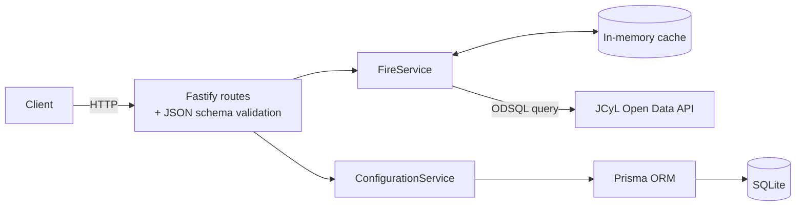

# 🔥 Forest Fires API

REST API that exposes **forest fire data from Castilla y León** (Spain) in a clean, paginated and filterable format, including a **geospatial "fires near me" search**.

It wraps the [Junta de Castilla y León open data portal](https://analisis.datosabiertos.jcyl.es/explore/dataset/incendios-forestales/) and adds pagination metadata, filtering, distance calculation, caching and per-user saved filters.


## Features

- **Paginated listing** of fires from the last two years, newest first
- **Filtering** by province, probable cause, current status and maximum alert level
- **Nearby search**: fires within a radius (km) of a coordinate, with the distance to each fire calculated using the Haversine formula
- **In-memory caching** (60 s TTL) to avoid hammering the upstream open data API
- **Saved filter configurations** per user, persisted with Prisma + SQLite
- **Request validation** with Fastify JSON schemas
- **Interactive docs** with Swagger UI at `/docs`, served from an OpenAPI 3 spec
- **Unit tests** for services and helpers with Jest

## Architecture



```
src/
├── server.ts            # Fastify bootstrap + Swagger UI
├── routes/              # HTTP layer: endpoints and validation schemas
├── services/            # Business logic (fires, configurations)
├── utils/               # Typed fetch wrapper, date and Haversine helpers
├── types/               # Domain types and filter enums
├── cache.ts             # node-cache instance
└── tests/               # Jest unit tests
prisma/
├── schema.prisma        # FilterConfiguration model
└── migrations/
openapi.yaml             # API contract
```

## Getting started

**Requirements:** Node.js 18+ and npm.

```bash
git clone https://github.com/JoaquinJPB/forest-fires-api.git
cd forest-fires-api
npm install
npx prisma generate
npx prisma migrate deploy
npm run dev
```

The API runs on **http://localhost:3000** and the docs on **http://localhost:3000/docs**.

| Script | What it does |
| --- | --- |
| `npm run dev` | Start in watch mode with `ts-node-dev` |
| `npm run build` | Compile TypeScript to `dist/` |
| `npm start` | Run the compiled build |
| `npm test` | Run the test suite with coverage |

## API

| Method | Endpoint | Description |
| --- | --- | --- |
| `GET` | `/api/fires` | Paginated list of fires (`page`, `limit`) |
| `GET` | `/api/fires/filtered` | Filter by `provincia`, `causa_probable`, `situacion_actual`, `nivel_maximo_alcanzado` |
| `GET` | `/api/fires/nearby` | Fires within `radius` km of `lat`, `lon` |
| `POST` | `/api/configurations` | Save a user's filter configuration |
| `GET` | `/api/configurations/:userId` | Get a user's saved configurations |
| `GET` | `/health` | Health check |

`limit` accepts 1–100 (default 10) and `page` starts at 1.

### Examples

Fires within 25 km of Soria:

```bash
curl "http://localhost:3000/api/fires/nearby?lat=41.7636&lon=-2.4649&radius=25&limit=5"
```

Fires in the province of León, second page:

```bash
curl "http://localhost:3000/api/fires/filtered?provincia=León&page=2"
```

Save a filter for user 1:

```bash
curl -X POST http://localhost:3000/api/configurations \
  -H "Content-Type: application/json" \
  -d '{"userId": 1, "province": "Soria", "status": "Activo"}'
```

Every list endpoint returns the same paginated envelope (values shortened):

```json
{
  "page": 1,
  "page_size": 5,
  "total_current_page": 5,
  "total_pages": 12,
  "total": 58,
  "results": [
    {
      "provincia": ["Soria"],
      "termino_municipal": "...",
      "causa_probable": "...",
      "situacion_actual": "...",
      "nivel_maximo_alcanzado": "...",
      "fecha_de_inicio": "...",
      "posicion": { "lat": 41.76, "lon": -2.46 },
      "distancia_desde_origen": { "type": "km", "value": 3.2 }
    }
  ]
}
```

`distancia_desde_origen` is only included in `/nearby` results.

## Data source

Fire records come from the **"Incendios forestales"** dataset published by the Junta de Castilla y León on its open data portal. The API only returns fires that started in the last two years.

## Author

**Joaquín Pastore**, backend developer · [GitHub](https://github.com/JoaquinJPB) · [LinkedIn](https://www.linkedin.com/in/joaquin-pastore/)
